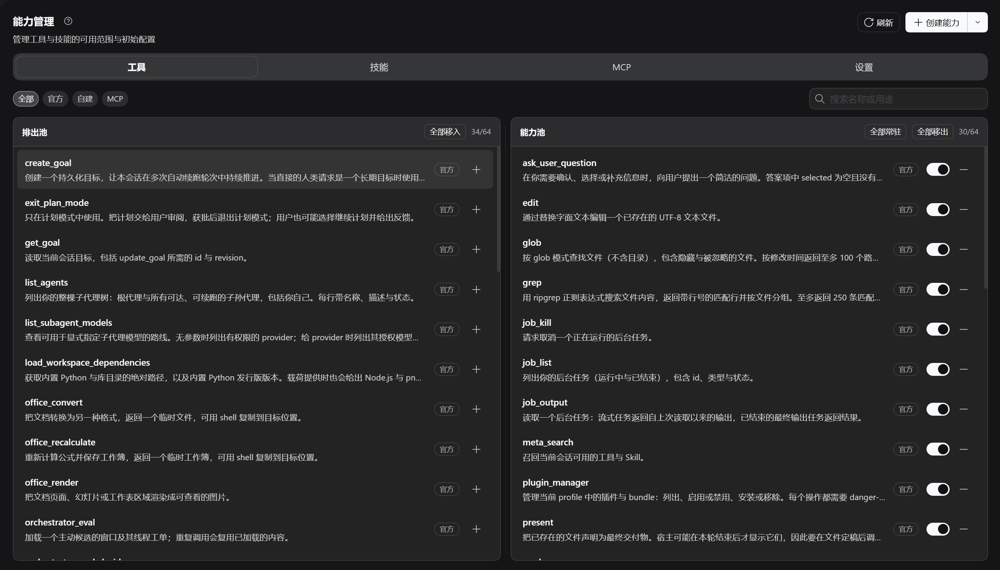
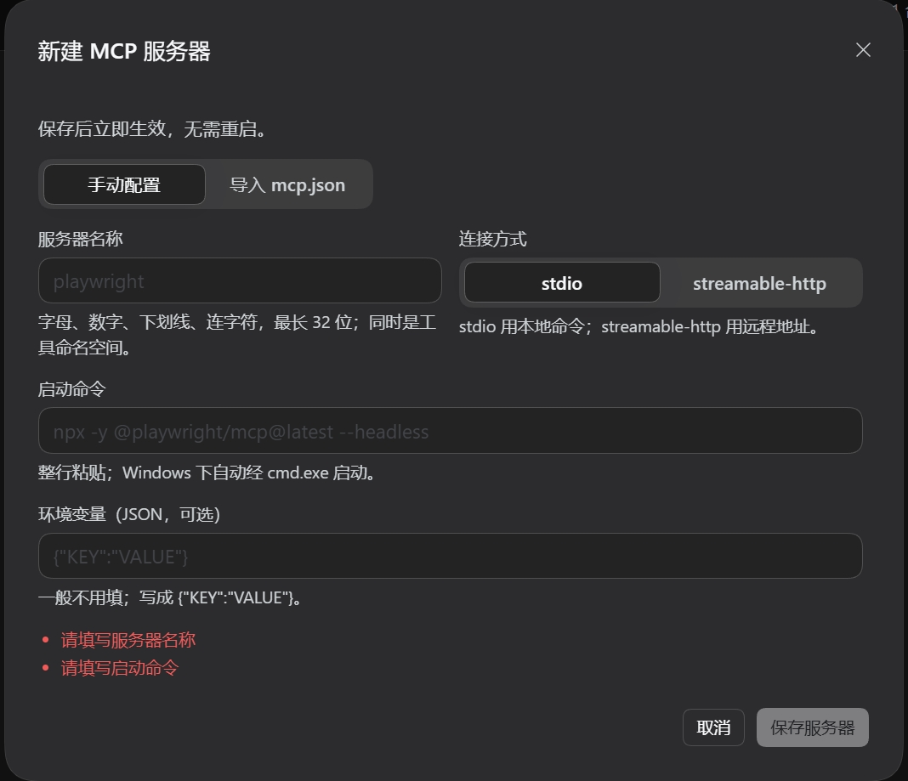
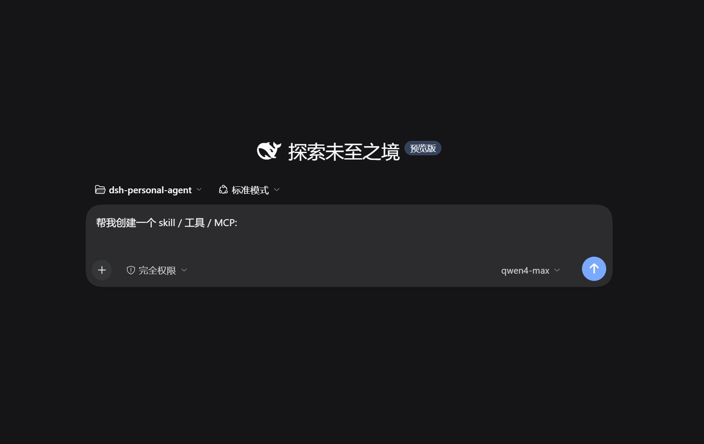

<p align="center">
  
</p>

<h1 align="center">Capability Manager Plugin</h1>

<p align="center">
  A global capability governance plugin built on <a href="https://github.com/deepseek-ai/deepseek-harness">DeepSeek Harness</a><br>
  The model starts with only a minimal capability set; other tools and Skills are recalled on demand via meta_search, reducing the interference of complex choices with Agent judgment
</p>

<p align="center">
  <b>English</b> · <a href="README.md">简体中文</a>
</p>

<p align="center">
  <a href="#"></a>
  <a href="#"></a>
  <a href="#"></a>
  <a href="#"></a>
  <a href="#"></a>
  <a href="#"></a>
  <a href="#"></a>
</p>

---

## Project Positioning

The set of tools visible to the model expands as plugins grow: the full schema of every tool consumes context and KV prefix; the more tools there are, the broader the model's choice space and the higher the decision cost.

This plugin changes capability provisioning from "static full set" to "governable on-demand surface": the **Capability Pool** is a hard allowlist, **Resident** determines the minimal set visible at startup, and **`meta_search`** is the on-demand recall channel; when dsh-personal-agent (a personal agent plugin by the same author) is detected, two **role blacklists** for Router / Worker are layered on top.

```text
Capability = Tool + Skill
Tool = Official tool + Custom tool + MCP tool
Skill = Official Skill + Custom Skill

Decision chain (first match wins):

  Role blacklist ──► Capability pool ──► Resident ──► meta_search recall ──► Use
  (highest priority)  (hard allowlist)  (visible at startup)  (on-demand supply)
```

Out-of-the-box state: all capabilities are in the pool, only the two meta capabilities `meta_search` and `skill` are resident, the blacklist is empty, and vector retrieval is off. A new session starts with only these two entries; other capabilities are recalled by the model as tasks require.

---

## Highlights

✦ **Minimum startup surface + on-demand recall**
  - At startup, only the full schemas of resident capabilities are injected; other capabilities enter the session after being recalled via `meta_search` and **become callable from the next step**. Newly added capabilities **do not break the KV prefix cache**.
  - Recall records can be rebuilt from the session log: **previously recalled capabilities remain available after restart**, without needing to be recalled again.
  - **Payload-level deduplication** is performed before returning: items whose same-type payload is verbatim identical to the current context are removed, so the same schema does not repeatedly occupy context.

<table>
  <tr>
    <td width="35%" valign="top">
      
    </td>
    <td width="65%" valign="top">
      
    </td>
  </tr>
</table>

> A dual-pane transfer box manages in-pool / out-of-pool capabilities, row switches manage residency; the risk banner points out in real time configurations that would break the recall chain.

✦ **Two recall channels, two operating modes**
  - **Mode A (default, vector retrieval off)**: injects the tool index and Skill catalog (names and usage summaries only); the `names` channel recalls tools exactly by regex, is always available, and supports batching.
  - **Mode B (vector retrieval on)**: no longer injects the index; the `keywords` channel recalls tools and Skills by semantic similarity. The model is `bge-small-zh-v1.5` (int8 quantized ONNX, about 24 MB); on first enable it downloads and verifies over the network; on failure it stays off and displays the reason.

✦ **MCP connection management, same origin as official**
  - Create / edit / enable / disable / delete MCP servers in the UI, with support for batch import of `mcp.json`; switches take effect hot without restart.

✦ **Custom capabilities, hot-effective**
  - Built-in `skill-creator` and `tool-creator` Skills: let the Agent directly write custom tools (declarative shell / code-script) and custom Skills; writing to the state directory triggers watch and registration without restart.
  - You can also use "Create Skill manually" in the UI to generate a skeleton, edit it, and move it into the Capability Pool to enable; new capabilities enter the pool by default and are non-resident by default.

✦ **Role blacklist (optional integration)**
  - Appears only when Personal Agent's `paRoles` service is detected, with two configuration sections: Router / Worker; the blacklist has the highest priority and can exclude in-pool and resident capabilities, and applies only to sessions of the corresponding role.

---

## Core Concepts

| Concept | Description |
|------|------|
| **Capability** | Collective term for tools + Skills; tools include three sources: official / custom / MCP, and Skills include two sources: official / custom |
| **Capability Pool** | The full set of capabilities currently usable, a hard allowlist; out-of-pool capabilities cannot be called, recalled, or injected into context |
| **Excluded from Pool** | Capabilities excluded from the Capability Pool; in the left pane of the UI, click the plus sign to put them back |
| **Resident** | Subset of capabilities directly available at startup; can only be selected from the pool; non-resident capabilities must be recalled via `meta_search` |
| **`meta_search`** | Recall tool: `names` regex exact channel (tools only) + `keywords` semantic channel (tools and Skills, Mode B only); it is itself a normal in-pool capability and can be excluded or made non-resident |
| **`skill` (shadow)** | Skill loading tool after takeover: validates the pool and blacklist before rendering the body; coordinates with official catalog injection to avoid duplicate injection |
| **Payload-level deduplication** | Before recall returns, compare same-type payloads verbatim with the current context and remove only exact matches; tool index ≠ tool schema, and they are not deduplicated against each other |
| **Tool index / Skill catalog** | Name + summary lists injected in Mode A: the index lists only non-resident tools, and the catalog lists all in-pool Skills; Mode B injects neither |
| **Role blacklist** | Capability exclusion lists for Router / Worker respectively, with the highest priority; configurable only when Personal Agent is detected |
| **Session role binding** | Fallback for manually assigning a role to a session; the binding is dormant when Personal Agent has already made a determination |
| **Vector retrieval** | Semantic recall subsystem for Mode B: model download and verification, WordPiece tokenization, CLS pooling, cosine top-K, vectors incrementally cached by summary hash |

---

## Plugin Tools and Built-in Skills

| Name | Type | Purpose |
|---|---|---|
| **`meta_search`** | Tool | Recall in-pool capabilities: `names` (regex name groups, tools only, always available), `keywords` (semantic, Mode B only), `limit` (default 20, max 50); returns full tool schemas and Skill index entries |
| **`skill`** | Tool (shadow) | Load a Skill body by name; validates the capability pool and role blacklist before loading |
| **`skill-creator`** | Built-in Skill | Guides the Agent to create custom Skills; hot-effective on write |
| **`tool-creator`** | Built-in Skill | Guides the Agent to create custom tools; hot-effective on write |

> Recalled tools become callable from the **next step**: restriction rebuild takes effect at the next step; calling directly within the same step according to the returned schema will fail. This is the inherent delay of incremental provisioning.

---

## 📦 Installation

> **Version compatibility**: This plugin is compatible with **DeepSeek Harness `0.2.2-rc.5` and above**. Please install or upgrade the host first (before upgrading, **fully stop the dsh process** in an external terminal):
>
> Tip: You can copy the following paragraphs directly to an AI assistant such as Claude Codex to install this plugin. When using the web profile, replace `desktop` with `web` in the commands below.

### Option 1: Install everything with one command (recommended)

We provide an aggregation package that includes all the following features:
- `dsh-capability-manager` (Capability Manager)
- `dsh-personal-agent` (Personal Assistant)
- `dsh-run-python` (Python Workbench)

Run the following command in a terminal to install and configure all plugins at once:

**Desktop** (recommended: click the plugin page and enter the package name to install):

```
dsh-gzx-plugin
```
or
```bash
dsh plugin --profile desktop add dsh-gzx-plugin
```

---

### Option 2: Install individually as needed

[Capability Manager](https://github.com/GZX2211/dsh-capability-manager "If you need meta_search's on-demand tool recall, take a look")
```bash
dsh plugin add dsh-capability-manager
```

[Personal Assistant](https://github.com/GZX2211/dsh-personal-agent "If you need an assistant that can proactively get work done on its own, take a look (usually used together with the other two plugins, otherwise some capabilities will be missing)")
```bash
dsh plugin add dsh-personal-agent
```

[Python Workbench](https://github.com/GZX2211/dsh-run-python "If you need a tool that can directly execute Python code and maintain kernel state cell by cell, take a look")
```bash
dsh plugin add dsh-run-python
```

### Installation Troubleshooting

**pnpm interception prompt: declares build scripts, requires `allowBuilds`** (common)

File manager location: `%USERPROFILE%\.dsh\profiles\desktop\pnpm-workspace.yaml`; add the package names given in the error to the `allowBuilds` list, save, and reinstall.

### Uninstall

```bash
dsh plugin --profile desktop remove dsh-capability-manager
```

> If you no longer use it, you can also clean up the state directory: `~/.dsh/state/capability-manager/` (MCP configuration is not included; it is stored in the official configuration, and uninstalling the plugin does not affect configured servers).

## Quick Start

- Want to understand the project architecture? See [Architecture](docs/architecture.en.md)
- Want to contribute? See [Contributing](docs/CONTRIBUTING.en.md)
- Want to learn how to use the plugin? See [User Guide](docs/USER_GUIDE.en.md)
- Want to do secondary development? See [Development Guidelines](AGENTS.en.md)
- How to install and get a project overview? This file [README.en.md](README.en.md)

---

## Data Storage

Plugin private state is located at `<DSH_HOME>/state/capability-manager/` (falls back to `~/.dsh/state/capability-manager/` when `DSH_HOME` is not set):

```
config.json                 # pool / resident / blacklist / vector retrieval / role binding (atomic write, self-healing reads)
tools/<name>/               # custom tools: meta.json (declarative shell/http) + optional impl.mjs (code)
skills/<name>/              # custom Skills: SKILL.md + references/
models/bge-small-zh-v1.5/   # vector model weights, tokenizer, manifest and vector cache vectors.json
```

> MCP configuration is **not** in the state directory: it is written to the profile configuration via the official `config-editor`, sharing the same source as the official Settings. Session recall records are not persisted; they are rebuilt from the session log after restart.

---

## Local Development

```bash
git clone https://github.com/GZX2211/dsh-capability-manager.git
cd dsh-capability-manager
pnpm install
pnpm build
dsh plugin --profile desktop add "link:$PWD"
```

Common commands:

```bash
pnpm typecheck      # Type checking
pnpm test           # Unit + integration tests (vitest)
pnpm build          # Build Host + Client (tsdown)
pnpm check          # Type checking + tests + build
```

> After modifying the Client, rebuild and hard-refresh the browser; after modifying the Host, restart dsh or the desktop app. For layered development guidelines, see `AGENTS.md` in the root directory and in each `src/` and `tests/` subdirectory.

---

## Known Limitations

| Item | Description |
|---|---|
| Tightening configuration is visible to ongoing sessions with delay | The host's `addition-only` protocol does not send tool removal notifications; the UI warns truthfully, and a new session can be created if necessary |
| Recall has a one-step delay | Tools recalled in the same step can only be executed in the next step |
| Tools registered in the agent's own scope are not governed by the pool | Semantic boundary of `restrict`; such tools are session-specific |
| Custom code tools have no sandbox | Executed in the same process as the host; prefer declarative tools, and review code tools yourself |
| The recall set of long-running sessions grows with history | The recall set is rebuilt from the session log without distinguishing why items were added; new sessions always behave correctly |

Future plans: Skill version control.

---

## License

MIT © GZX2211. Issues / PRs are welcome.