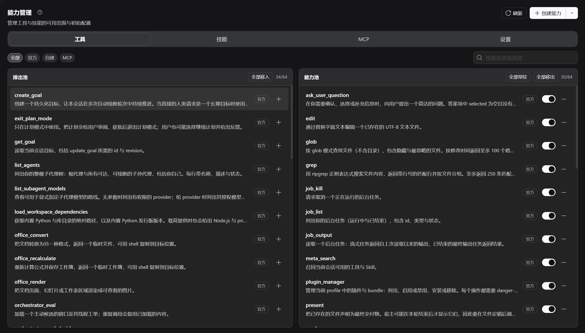
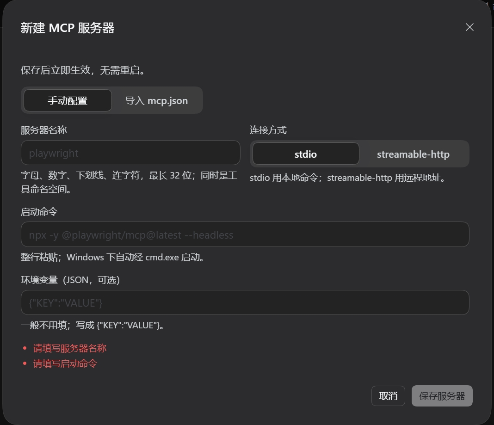
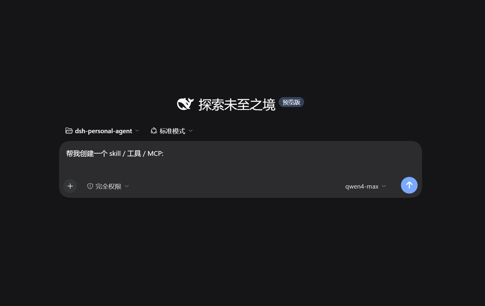

<p align="center">
  
</p>

<h1 align="center">能力管理插件</h1>

<p align="center">
  基于 <a href="https://github.com/deepseek-ai/deepseek-harness">DeepSeek Harness</a> 打造的全局能力治理插件<br>
  模型启动时只带最小能力集，其余工具与 Skill 通过 meta_search 按需召回，减少复杂选择干扰 Agent 判断
</p>

<p align="center">
  <a href="README.en.md">English</a> · <b>简体中文</b>
</p>

<p align="center">
  <a href="#"></a>
  <a href="#"></a>
  <a href="#"></a>
  <a href="#"></a>
  <a href="#"></a>
  <a href="#"></a>
  <a href="#"></a>
</p>

---

## 项目定位

模型可见的工具集会随插件增长而膨胀：每个工具的完整 schema 都占用上下文与 KV 前缀，工具越多，模型的选择面越宽、判断成本越高。

本插件把能力供给从「静态全量」改为「可治理的按需面」：**能力池**是硬白名单，**常驻**决定启动即见的最小集合，**`meta_search`** 是按需召回通道；检测到 dsh-personal-agent（同作者的个人代理插件）时，再叠加 Router / Worker 两个**角色黑名单**。

```text
能力 = 工具 + Skill
工具 = 官方工具 + 自建工具 + MCP 工具
Skill = 官方 Skill + 自建 Skill

判定链（先命中先决定）：

  角色黑名单 ──► 能力池 ──► 常驻 ──► meta_search 召回 ──► 使用
  （最高优先级）  （硬白名单） （启动即见）   （按需供给）
```

开箱状态：全部能力在池内，只常驻 `meta_search` 与 `skill` 两个元能力，黑名单为空，向量检索关闭。新会话一开始只有这两个入口，其余能力由模型按任务需要召回。

---

## 核心亮点

✦ **最小启动面 + 按需召回**
  - 启动只注入常驻能力的完整 schema；其余能力经 `meta_search` 召回后进入会话，**从下一步开始可调用**，新增能力**不破坏 KV 前缀缓存**。
  - 召回记录可从会话日志重建：**重启后此前召回的能力仍然可用**，不需要重新召回。
  - 返回前执行**载荷级去重**：与当前上下文同类型载荷逐字一致的项被剔除，同一份 schema 不会反复占用上下文。

<table>
  <tr>
    <td width="35%" valign="top">
      
    </td>
    <td width="65%" valign="top">
      
    </td>
  </tr>
</table>

> 双栏穿梭框管理池内 / 池外，行内开关管理常驻；风险提示条实时指出会让召回断链的配置。

✦ **两种召回通道，两种运行模式**
  - **模式 A（默认，向量检索关闭）**：注入工具索引与技能目录（只有名称与用途摘要）；`names` 通道按正则精确召回工具，永远可用、支持批量。
  - **模式 B（向量检索开启）**：不再注入索引，`keywords` 通道按语义相似度召回工具与 Skill。模型为 `bge-small-zh-v1.5`（int8 量化 ONNX，约 24 MB），首次开启联网下载并校验，失败保持关闭并提示原因。

✦ **MCP 连接管理，与官方同源**
  - 界面内新建 / 编辑 / 启停 / 删除 MCP 服务器，支持批量导入 `mcp.json`；开关热生效，无需重启。

✦ **自建能力，热生效**
  - 内置 `skill-creator`、`tool-creator` Skill：让 Agent 直接写出自建工具（声明式 shell / 代码脚本式）与自建 Skill，写入状态目录即被监听注册，无需重启。
  - 也可在界面「手动创建技能」生成骨架，编辑后移入能力池启用；新建能力默认进池、默认不常驻。

✦ **角色黑名单（可选集成）**
  - 仅在检测到 Personal Agent 的 `paRoles` 服务时出现 Router / Worker 两个配置区；黑名单优先级最高，可排除池内与常驻能力，只作用于对应角色的会话。

---

## 核心概念

| 概念 | 说明 |
|------|------|
| **能力** | 工具 + Skill 的统称；工具含官方 / 自建 / MCP 三类来源，Skill 含官方 / 自建两类 |
| **能力池** | 当前可被使用的能力全集，硬白名单；池外能力不可调用、不可召回、不注入上下文 |
| **排出池** | 被排除出能力池的能力；界面左栏，点加号可放回 |
| **常驻** | 启动即直接可用的能力子集，只能从池内选；非常驻能力须经 `meta_search` 召回 |
| **`meta_search`** | 召回工具：`names` 正则精确通道（只召回工具）+ `keywords` 语义通道（工具与 Skill，仅模式 B）；本身是普通池内能力，可被排除或取消常驻 |
| **`skill`（shadow）** | 接管后的 Skill 加载工具：校验池与黑名单后渲染正文；与官方目录注入协同，避免重复注入 |
| **载荷级去重** | 召回返回前与当前上下文的同类型载荷逐字比较，完全一致才剔除；工具索引 ≠ 工具 schema，不互相判重 |
| **工具索引 / 技能目录** | 模式 A 注入的名称 + 摘要清单：索引只列非常驻工具，目录列全部池内 Skill；模式 B 不注入 |
| **角色黑名单** | Router / Worker 各自的能力排除表，优先级最高；仅在检测到 Personal Agent 时可配置 |
| **会话角色绑定** | 手动给会话指定角色的补足手段；Personal Agent 已判定时绑定休眠 |
| **向量检索** | 模式 B 的语义召回子系统：模型下载校验、WordPiece 分词、CLS 池化、余弦 top-K，向量按摘要哈希增量缓存 |

---

## 插件工具与内置 Skill

| 名称 | 类型 | 用途 |
|---|---|---|
| **`meta_search`** | 工具 | 召回池内能力：`names`（正则名称组，只召回工具，永远可用）、`keywords`（语义，仅模式 B）、`limit`（默认 20，上限 50）；返回工具完整 schema 与 Skill 索引条目 |
| **`skill`** | 工具（shadow） | 按名称加载 Skill 正文；加载前校验能力池与角色黑名单 |
| **`skill-creator`** | 内置 Skill | 指导 Agent 创建自建 Skill，写入即热生效 |
| **`tool-creator`** | 内置 Skill | 指导 Agent 创建自建工具，写入即热生效 |

> 召回的工具从**下一步**开始可调用：restriction 重建在下一个 step 生效，同一 step 内照返回的 schema 直接调用会失败，这是增量供给的固有延迟。

---

## 📦 安装

> **版本适配**：本插件适配 **DeepSeek Harness `0.2.2-rc.5`及以上版本**。请先安装或升级宿主（升级前先在外部终端**完全停止 dsh 进程**）：
>
> tips：可直接将以下段落复制给 Claude Codex 等 AI 助手安装该插件。使用 web profile 时，把下文命令中的 `desktop` 换成 `web`。

### 方式一：一键安装全部（推荐）

我们提供了一个聚合包，包含以下所有功能：
- `dsh-capability-manager`（能力管理器）
- `dsh-personal-agent`（个人助手）
- `dsh-run-python`（Python 工作台）

在终端执行以下命令，即可一次性安装并配置所有插件：

**桌面端**（推荐点击插件页面直接输入包名安装）：

```
dsh-gzx-plugin
```
或
```bash
dsh plugin --profile desktop add dsh-gzx-plugin
```

---

### 方式二：按需单独安装

[能力管理器](https://github.com/GZX2211/dsh-capability-manager "如果你需要 meta_search 的 tool 按需召回功能，不妨了解一下")
```bash
dsh plugin add dsh-capability-manager
```

[个人助手](https://github.com/GZX2211/dsh-personal-agent "如果你需要一个能自己“主动”干活的助手，不妨了解一下（通常与另两个插件搭配使用，否则会缺失部分能力）")
```bash
dsh plugin add dsh-personal-agent
```

[python 工作台](https://github.com/GZX2211/dsh-run-python "如果你需要一个能直接执行 Python 代码并逐 cell 维持内核状态的工具，不妨了解一下")
```bash
dsh plugin add dsh-run-python
```

### 安装问题速查

**pnpm 拦截提示：声明了构建脚本，需要 `allowBuilds`**（常见）

文件管理器定位：`%USERPROFILE%\.dsh\profiles\desktop\pnpm-workspace.yaml`，把报错中给出的包名添加到 `allowBuilds` 列表里，保存再重新安装。

### 卸载

```bash
dsh plugin --profile desktop remove dsh-capability-manager
```

> 如不再使用可同步清理状态目录：`~/.dsh/state/capability-manager/`（MCP 配置不在其中，它存于官方配置，卸载插件不影响已配置的服务器）。

## 快速开始

- 了解项目架构？请看 [架构文档](docs/architecture.md)
- 参与贡献？请看 [贡献](docs/CONTRIBUTING.md)
- 了解如何使用插件？请看 [用户使用手册](docs/USER_GUIDE.md)
- 二次开发？请看 [开发规范](AGENTS.md)
- 如何安装以及项目概览？本文件 [README.md](README.md)

---

## 数据存储

插件私有状态位于 `<DSH_HOME>/state/capability-manager/`（无 `DSH_HOME` 时退回 `~/.dsh/state/capability-manager/`）：

```
config.json                 # 池 / 常驻 / 黑名单 / 向量检索 / 角色绑定（原子写，读取自愈）
tools/<name>/               # 自建工具：meta.json（声明式 shell/http）+ 可选 impl.mjs（代码）
skills/<name>/              # 自建 Skill：SKILL.md + references/
models/bge-small-zh-v1.5/   # 向量模型权重、tokenizer、manifest 与向量缓存 vectors.json
```

> MCP 配置**不在**状态目录里：它经官方 `config-editor` 写入 profile 配置，与官方 Settings 同源。会话召回记录不落盘，重启后从会话日志重建。

---

## 本地开发

```bash
git clone https://github.com/GZX2211/dsh-capability-manager.git
cd dsh-capability-manager
pnpm install
pnpm build
dsh plugin --profile desktop add "link:$PWD"
```

常用命令：

```bash
pnpm typecheck      # 类型检查
pnpm test           # 单元 + 集成测试（vitest）
pnpm build          # 构建 Host + Client（tsdown）
pnpm check          # 类型检查 + 测试 + 构建
```

> 修改 Client 需重新构建并硬刷新浏览器；修改 Host 需重启 dsh 或桌面端。分层开发规范见根目录与各 `src/`、`tests/` 子目录的 `AGENTS.md`。

---

## 已知限制

| 项 | 说明 |
|---|---|
| 收紧配置对进行中会话延迟可见 | 宿主 `addition-only` 协议不发送工具移除通知；界面如实提示，必要时新建会话 |
| 召回有一步延迟 | 同一 step 内召回的工具要等下一步才可执行 |
| agent 自身 scope 注册的工具不受池管辖 | `restrict` 的语义边界；这类工具属于会话专属 |
| 自建代码工具无沙箱 | 与宿主同进程执行；优先使用声明式工具，代码工具需自行审阅 |
| 长期会话的召回集合会随历史增长 | 召回集合从会话日志重建，不区分新增原因；新会话行为始终正确 |

后续规划：Skill 版本控制。

---

## 许可

MIT © GZX2211。欢迎提 Issue / PR。