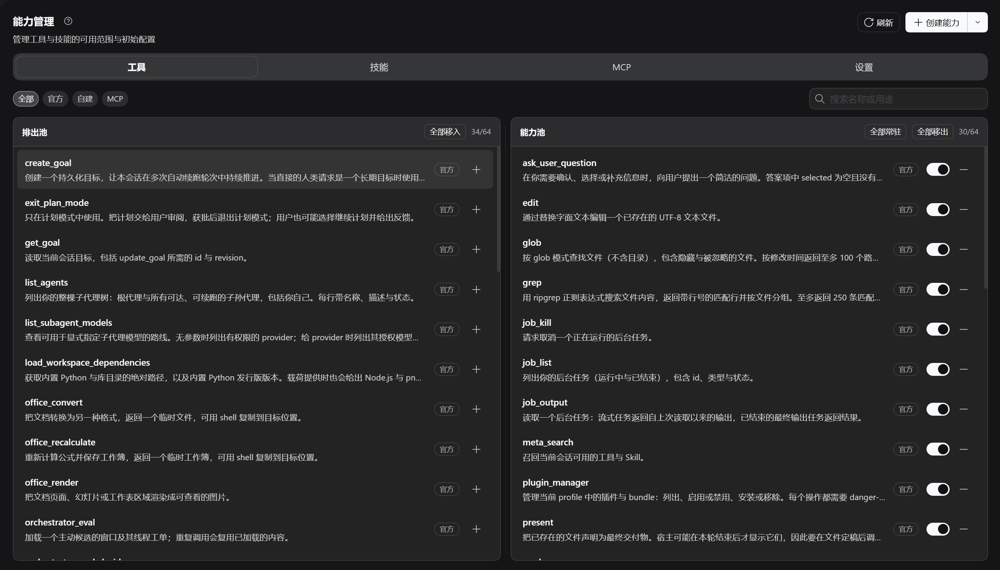
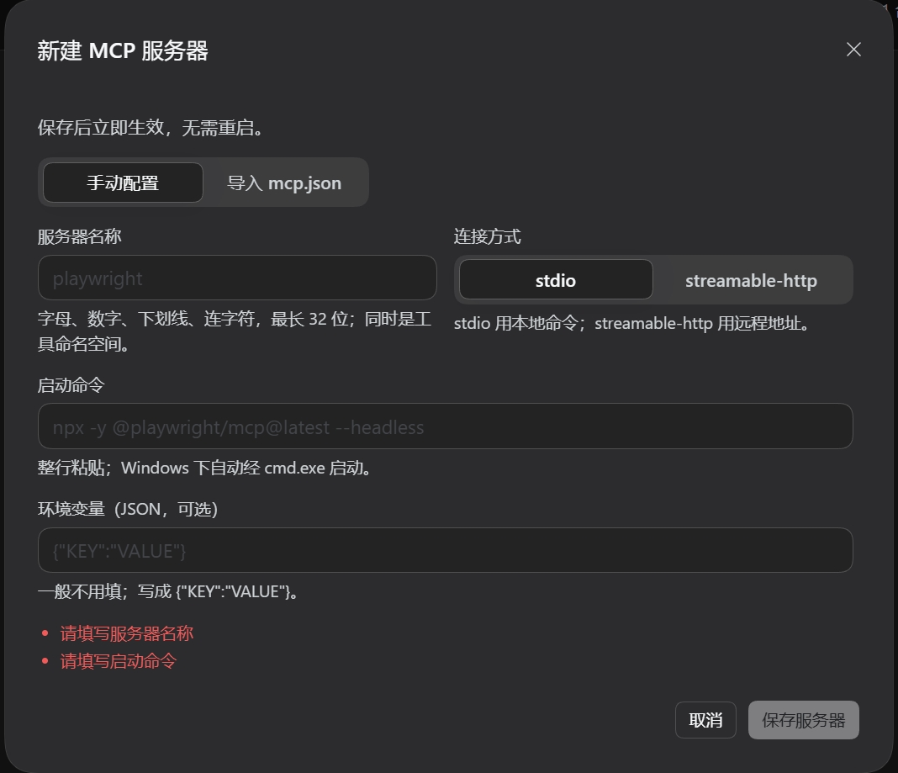

# User Guide

<p>
  <b>English</b> · <a href="USER_GUIDE.md">简体中文</a>
</p>

This document focuses only on the actual operation of the plugin and explains **how to use** each feature;
for basic concepts and installation, see the [README](../README.en.md).

## 1. The Main View

<p align="center">
  
</p>

> Click the "Capabilities" entry in the official left sidebar (below the "Plugins" button) to open the manager. All capability governance happens on this single page.

From top to bottom:

| Area | Content |
|---|---|
| Header | Title, help button (?), **Refresh**, the **Create capability** split button |
| Tabs | **Tools** / **Skills** / **MCP** / **Settings** |
| Toolbar | Source filter pills (All / Official / Custom / MCP) + search box (substring match on name and purpose, filters as you type) |
| Transfer panes | Left: **Excluded**; right: **Pool**; the divider between them is draggable (also ← / → to nudge, Home / End to the edges, double-click to reset) |

Extra: what is inside the help button (?)?
- It explains the transfer panes, the resident switch, the recall mechanism, and whether you are in mode A or mode B.
- It states two easily misunderstood rules explicitly: **loading a skill with `/name` is not restricted by the pool**; **recalled results become callable from the next step on**.

## 2. Managing the Pool and Residency

Each capability has exactly two configurable states:

| State | Operation | Effect |
|---|---|---|
| **In pool / out of pool** | Click the **minus** on a pool row to move it out; click the **plus** on an excluded row to put it back | Out of pool: cannot be called, recalled, or listed in the index; moving out also clears residency |
| **Resident / non-resident** | The **resident switch** inside a pool row | Resident: available immediately at startup; non-resident: must be recalled by name through `meta_search` |

Key points:

1. Residency can only be chosen from the pool; resident items are pinned to the top of the pool pane.
2. The pane counters (e.g. `3/26`) use the **current filtered result** as the denominator, not all capabilities.
3. Custom capability rows have an **Open folder** button (left of the plus / minus) that opens the source directory in the file manager.
4. Changes are saved immediately; if another window changed the configuration meanwhile, you will see "The configuration changed in another window; reloaded".

### What the warnings mean

| Warning | Meaning |
|---|---|
| `meta_search` is not resident | Non-resident pool capabilities cannot be recalled |
| `meta_search` is excluded | Nothing can be recalled; the model works with resident capabilities only |
| The `skill` tool is excluded | No skill can be loaded |
| Nothing is resident | The model starts with no capability available |
| The blacklist excludes resident capabilities | Those capabilities become unavailable for that role |

> All of these configurations are **legal**—the plugin will not stop you, it only reports the consequences honestly. Deliberately tightening to the limit is a valid use too.

## 3. How Recall Happens

You never trigger recall manually: the model calls `meta_search` itself during a session. Understanding its behavior helps you judge whether your configuration is sound.

```text
Session start: the model sees only resident capabilities (meta_search + skill by default)
   │
   ├─ Mode A: a tool index + skill catalog are injected (names and summaries only)
   │    the index tells the model what exists → meta_search(names: "read|grep") fetches full definitions
   │
   └─ Mode B: no index is injected
        meta_search(keywords: "read file contents") recalls tools and skills semantically
   │
   ▼
Recall returns: tools come with full schemas (callable from the next step); skills come as index entries (load the body via skill)
   │
   ▼
Restart / resume: previously recalled tools are rebuilt from the session log and remain available—no re-recall needed
```

A few behaviors worth knowing:

- **The `names` channel recalls tools only**; it accepts regex name groups like `read|write|edit` and is always available. Skills load directly from the resident catalog in mode A, and are recalled through `keywords` in mode B.
- **A `names` hit on a skill name returns only a note**, never entries: in mode A it says "the skill catalog is already in context—load it directly via skill"; in mode B it says "use keywords for semantic recall instead".
- **Dedupe is payload-level**: only payloads byte-identical to the current context are dropped. An empty return is not a failure—the target capability may already be in context.
- **A tool recalled within a step cannot execute in that same step**; it becomes callable from the next step, and the return value says so.

## 4. Vector Search (Switching Mode A / B)

In **Settings → Vector search**:

1. Turn on **Enable vector search**. The first enable downloads the ~24 MB `bge-small-zh-v1.5` model (int8-quantized ONNX) from the network; the UI shows download / load status—please wait.
2. Once downloaded and verified, you enter **mode B**: no index is injected, and `keywords` semantic recall becomes active.
3. A failed download or load **keeps it off** and shows the reason here; exact regex recall is never affected.
4. Turning the switch off returns to **mode A** and the index is injected again.

> The mode is a global switch affecting all sessions. Model files and the vector cache live under `models/` in the plugin state directory; deleting them causes a re-download on the next enable.

## 5. MCP Connection Management

The **MCP** tab manages MCP server connections. The configuration here is **the same one** the Agent and the official Settings use: a server added on either side appears in the same list with the same name, transport, and state.

<p align="center">
  
</p>

### Adding a server

Click **Configure MCP** in the top-right; two views:

- **Fill in manually**: enter the server name (letters, digits, underscore, hyphen; up to 32 characters—it is also the tool namespace); choose the transport—`stdio` takes a one-line launch command (run through cmd.exe automatically on Windows), `streamable-http` takes an endpoint URL; environment / headers are optional JSON objects.
- **Import mcp.json**: paste an `mcp.json`, preview each server, then write them in batch; same-name entries are overwritten and their enabled state is kept. The `sse` transport is not supported—use `streamable-http` or `stdio`.

Saving **takes effect immediately, no restart needed**. Once connected, the server's tools enter the capability pool by default; manage them back on the Tools tab (source filter: MCP).

## 6. Creating Custom Capabilities

The **Create capability** split button in the header offers two ways:

### Let the Agent create it

Clicking it opens a new session pre-filled with "Help me create a skill / tool / MCP: "—continue typing your request after the colon. The built-in Skill guides the Agent to:

> Security note: custom code tools run in the host process with no sandbox..

### Create a skill manually

Click **Create a skill manually**: you are taken to the Skills tab, and a new entry appears pinned at the top of the Excluded pane (default name `my-skill`, auto-numbered on collision) with a "Custom" tag. Click its **Open folder** button, edit the `SKILL.md` (the skeleton already contains frontmatter and filling guidance) and `references/`, then click the plus to move it into the pool and enable it.

## 7. Role Blacklists & Session Roles (Personal Agent required)

**Only when the Personal Agent plugin (`ctx.paRoles` service) is detected** do the "Role blacklists" and "Session roles" sections appear in Setting.

### Role blacklists

Two side-by-side panels for Router and Worker, each with a searchable list:

- The in-row switch means "**disable for this role**"; disabled items are pinned to the top; the pane header carries a "disabled n/m" counter and a **Clear** action.
- Type filter pills: All / Tools / Skills; counters only count the filtered-and-searched set.
- Out-of-pool capabilities are still listed and tagged "Excluded": the blacklist and the pool are independent—configure first, pool later is a valid workflow.
- **A blacklist outranks everything**: it excludes pooled and resident capabilities alike; the two roles are independent, and sessions with an unknown role are unaffected by either.

## 8. Common Questions

- **The model says it has no tools / recall returns nothing**: check that `meta_search` is resident and in the pool (see the warning bar); confirm the target capability is pooled and not excluded by the current role's blacklist.
- **Do tools survive a restart?** Yes. Previously recalled tools are rebuilt from the session log—no re-recall needed.
- **Why can an out-of-pool skill still load via `/name`?** Explicit use outranks governance—this is by design; the pool only constrains the model's autonomous calls, the catalog, and recall.
- **An MCP server keeps showing "Connection failed"**: read the failure reason on the state dot; verify the launch command / endpoint and that dependencies are installed; when credentials are missing, configure them via the official credential templates.
- **Enabling vector search failed**: staying off is the intended degradation; fix the network or disk issue shown in the UI and retry—exact recall is always available.

If you hit a problem you cannot solve, note the situation and reproduce it once more (if possible), then raise it in an issue; if you are good at locating problems and fixing code, a PR is welcome too—I will handle it promptly.