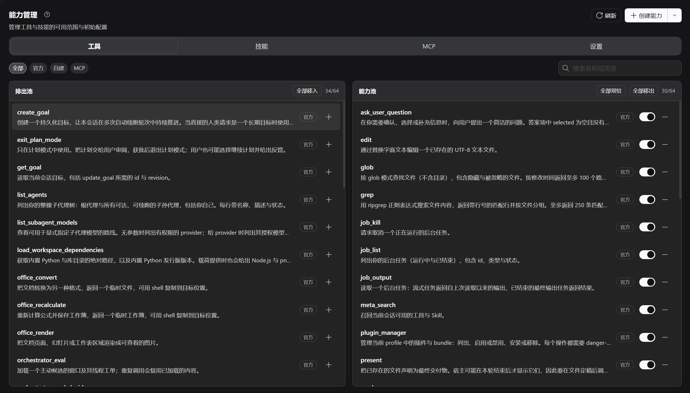
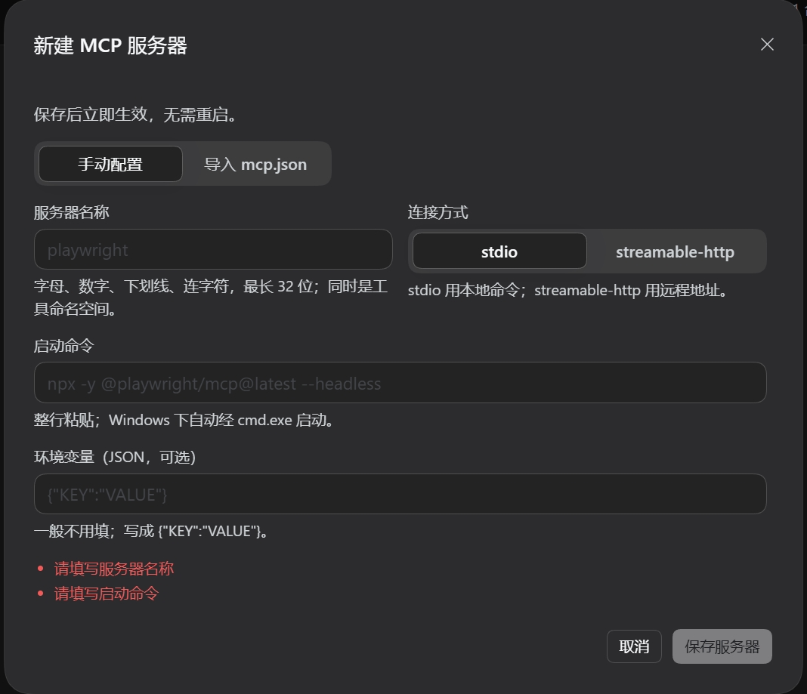

# 用户使用手册

<p>
  <a href="USER_GUIDE.en.md">English</a> · <b>简体中文</b>
</p>

本文只聚焦插件的实际操作，指导**如何使用**其中的每一个功能；
基础概念和安装方式请见 [README](../README.md)。

## 1. 认识主界面

<p align="center">
  
</p>

> 点击官方左侧边栏的「能力管理」入口（位于「插件」按钮下方）打开管理页。所有能力治理都在这一个页面完成。

页面自上而下：

| 区域 | 内容 |
|---|---|
| 页头 | 标题、帮助按钮（?）、**刷新**、**创建能力**分裂按钮 |
| Tab | **工具** / **技能** / **MCP** / **设置** |
| 工具栏 | 来源筛选胶囊（全部 / 官方 / 自建 / MCP）+ 搜索框（对名称与用途做子串匹配，输入即筛） |
| 双栏穿梭框 | 左栏**排出池**、右栏**能力池**；中间分隔条可拖动（也支持 ← / → 微调、Home / End 到边界、双击复位） |

补充：帮助按钮（?）里有什么？
- 解释穿梭框与常驻开关的含义、召回机制，以及当前处于模式 A 还是模式 B。
- 明确写出两条容易被误解的规则：**`/名称` 显式加载技能不受能力池限制**；**召回的结果从下一步开始可调用**。

## 2. 管理能力池与常驻

每个能力只有两个可配状态：

| 状态 | 操作 | 效果 |
|---|---|---|
| **池内 / 池外** | 能力池行点**减号**移出；排出池行点**加号**放回 | 池外：不可调用、不可召回、不出现在索引；移出时同时取消常驻 |
| **常驻 / 非常驻** | 能力池行内的**常驻开关** | 常驻：启动即直接可用；非常驻：只能经 `meta_search` 按名字召回 |

操作要点：

1. 常驻只能从池内选；能力池内常驻项自动置顶。
2. 两栏计数（如 `3/26`）的分母是**当前筛选结果**，不是全部能力。
3. 自建能力行有**打开目录**按钮（加号 / 减号左侧），点击在文件管理器中打开它的源目录。
4. 改动即时保存；如果另一个窗口同时改了配置，会提示「配置已被其他窗口修改，已重新读取」。

### 风险提示都在说什么

| 提示 | 含义 |
|---|---|
| `meta_search` 不在常驻里 | 池内那些非常驻能力将无法被召回 |
| `meta_search` 已被排除出池 | 完全无法召回，模型只能用常驻能力工作 |
| `skill` 已被排除出池 | 所有技能都无法加载 |
| 常驻为空 | 模型启动时没有任何直接可用的能力 |
| 黑名单排除了常驻能力 | 这些能力对该角色将不可用 |

> 这些配置都是**合法的**——插件不会阻止你，只如实提示后果。刻意收紧到极限也是一种用法。

## 3. 召回是怎么发生的

你不需要手动操作召回：模型在会话中自己调用 `meta_search`。理解它的行为有助于你判断配置是否合理。

```text
会话启动：模型只看到常驻能力（默认 meta_search + skill）
   │
   ├─ 模式 A：上下文注入工具索引 + 技能目录（只有名称与摘要）
   │    模型凭索引知道「有什么」→ 调 meta_search(names: "read|grep") 取回完整定义
   │
   └─ 模式 B：不注入索引
        模型调 meta_search(keywords: "读取文件内容") 语义召回工具与技能
   │
   ▼
召回返回：工具给完整 schema（下一步开始可调用）；技能给索引条目（再调 skill 加载正文）
   │
   ▼
重启 / 恢复会话：此前召回的工具从会话日志重建，仍然可用，无需重新召回
```

几条需要知道的行为：

- **`names` 通道只召回工具**，支持 `read|write|edit` 这样的正则名称组，永远可用；技能在模式 A 凭常驻目录直接加载，在模式 B 走 `keywords` 语义召回。
- **用 `names` 命中技能名只会返回说明**而不是条目：模式 A 提示「技能目录已在上下文中，直接用 skill 加载」；模式 B 提示「请改用 keywords 语义召回」。
- **去重是载荷级的**：只有与当前上下文逐字一致的载荷才被剔除。返回为空不代表失败，可能目标能力已经在上下文里。
- **同一 step 内召回的工具不能立即执行**，下一步开始可调用；返回值里已写明这一点。

## 4. 向量检索（模式 A / B 切换）

在**设置 → 向量检索**分区：

1. 打开**启用向量检索**开关。首次开启需要联网下载约 24 MB 的 `bge-small-zh-v1.5` 模型（int8 量化 ONNX），期间界面显示下载 / 加载状态，请耐心等待。
2. 下载并校验通过后进入**模式 B**：不再注入索引，`keywords` 语义召回生效。
3. 下载或加载失败会**保持关闭**并在此显示原因；正则精确召回不受任何影响。
4. 关闭开关即回到**模式 A**，索引恢复注入。

> 模式是全局开关，对所有会话生效。模型文件与向量缓存存放在插件状态目录的 `models/` 下，删除后下次开启会重新下载。

## 5. MCP 连接管理

**MCP** Tab 管理 MCP 服务器连接。这里的配置与 Agent、官方 Settings 是**同一份**：任何一边添加的服务器都会出现在同一列表，名称、传输方式、状态一致。

<p align="center">
  
</p>

### 新建一台服务器

点右上角**配置 MCP**，两种视图：

- **手动配置**：填服务器名称（字母、数字、下划线、连字符，最长 32 位，同时是工具命名空间）；选连接方式——`stdio` 填整行启动命令（Windows 下自动经 cmd.exe 启动），`streamable-http` 填服务地址；环境变量 / 请求头按需填 JSON 对象。
- **导入 mcp.json**：粘贴一份 `mcp.json`，预览每台服务器后批量写入；同名条目会被覆盖，原有启用状态保留。不支持 `sse` 传输，请改用 `streamable-http` 或 `stdio`。

保存后**立即生效，无需重启**。连接成功后，该服务器的工具默认进入能力池，回到工具页即可管理（来源筛选选 MCP）。

## 6. 创建自建能力

页头右上角**创建能力**分裂按钮，两种方式：

### 让 Agent 创建能力

点击后跳转新会话并预填「帮我创建一个 skill / 工具 / MCP: 」，在冒号后补上你的需求即可。内置 Skill 会指导 Agent：

> 安全提醒：自建代码工具与宿主同进程运行，没有沙箱。

### 手动创建技能

点击**手动创建技能**：自动跳到技能页，排出池顶部出现一个新条目（默认名 `my-skill`，冲突时自动编号），带「自建」标签。点它的**打开目录**按钮，编辑 `SKILL.md`（骨架已含 frontmatter 与填写指引）与 `references/`，完成后点加号移入能力池即启用。

## 7. 角色黑名单与会话角色（需 Personal Agent）

**仅当检测到 Personal Agent 插件（`ctx.paRoles` 服务）时**，设置页才出现「角色黑名单」与「会话角色」两个分区。

### 角色黑名单

Router（路由）与 Worker（执行）两个并排面板，各自一份可搜索列表：

- 行内开关表示「**对该角色禁用**」；已禁用项置顶；标题栏有「已禁用 n/m」计数与**清空**入口。
- 类型筛选胶囊：全部 / 工具 / 技能；计数只统计筛选与搜索之后的集合。
- 池外能力照常列出并标注「池外」：黑名单与池互相独立，先配置、后入池是合法用法。
- **黑名单优先级最高**：既排除池内能力，也排掉常驻能力；两个角色互相独立，未识别角色的会话不受任何黑名单影响。

## 8. 常见操作问题

- **模型说没有可用工具 / 召回不到东西**：检查 `meta_search` 是否常驻且在池内（看风险提示条）；确认目标能力在池内、未被当前角色黑名单排除。
- **重启后工具还在吗**：在。此前召回的工具从会话日志重建，无需重新召回。
- **池外的技能为什么还能用 `/名称` 加载**：显式使用优先，这是设计行为；能力池只约束模型自主调用、目录与召回。
- **MCP 开关打开后一直「连接失败」**：查看状态点的失败原因；确认启动命令 / 服务地址正确、依赖已安装；缺少凭据时按官方凭据模板配置。。
- **向量检索开启失败**：保持关闭是预期降级；按界面提示的原因处理网络或磁盘问题后重试，精确召回始终可用。

遇到无法解决的问题时，记录当时情况再复现一次（如果可以），然后在 issue 中向我提出来；你如果很擅长定位问题并修改代码，也可以提交 PR；我会及时处理。